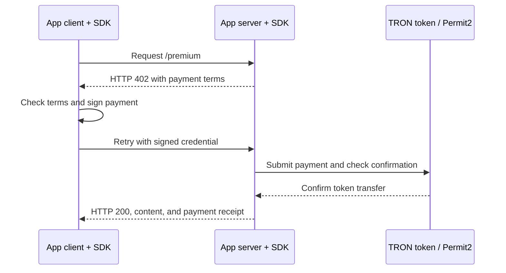
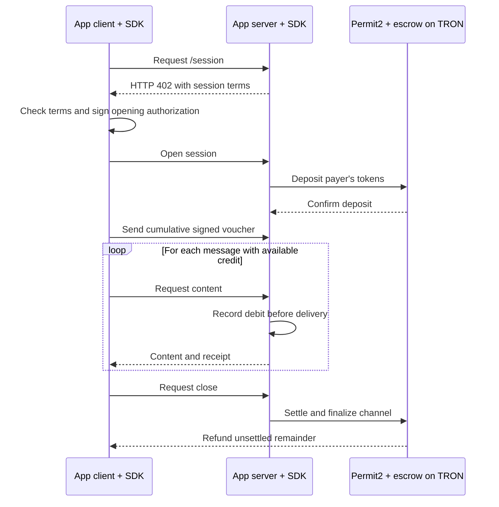

# TRON MPP SDK test app

This app lets you test the local `tron-mpp-sdk` with TRC-20 tokens on the TRON **Nile testnet**. It has two payment flows:

- **Charge:** pay once to get one response.
- **Session:** put tokens in an escrow, then pay for multiple messages using signed vouchers.

The default token is Nile USDT (`TXYZopYRdj2D9XRtbG411XZZ3kM5VkAeBf`). Payments use tokens, not native TRX. Wallets may still need Nile TRX or resources to send transactions.

## What happens where?

- **This app** provides the example client, HTTP server, commands, configuration, example content, and local storage. It chooses the price and checks that the payment terms match its settings. For sessions, the app decides when to debit each message.
- **The SDK** provides the TRON payment methods, challenge and credential handling, signature and payment verification, receipts, and session accounting and management. The app connects the SDK to TRON and provides storage for its records.
- **TRON contracts** hold or transfer the tokens. In a session, the separately deployed escrow holds the deposit until settlement or refund.

The app is a test harness. Its charge journal is in memory, and its session files are for a single local process. A production service needs suitable shared, persistent storage and recovery for its own content delivery.

## Setup for both flows

1. Use Node.js 22.22 or later. Make sure the SDK is available at `../tron-mpp-sdk`.

   Before the first build, ensure the **SDK's** `../tron-mpp-sdk/.env` exists. If it is missing, copy the SDK's `.env.example` to that path; preserve any existing file. Set `TRON_SESSION_ESCROW_ADDRESS` there to the deployed Nile escrow address. You can reuse an existing compatible deployment; see [Prepare a session](#prepare-a-session) for deployment requirements. This configuration is required to build the local SDK even when testing only charge.

   Then build the SDK and install this app's dependencies:

   ```sh
   cd ../tron-mpp-sdk
   npm run build
   cd ../tron-mpp-sdk-app-test
   npm install
   ```

   Rebuild the SDK after changing its code or escrow address, then restart running app processes so they use the updated build.

2. Back in the **app directory**, if you do not already have an app `.env` file, create one from the app's example:

   ```sh
   cp .env.example .env
   ```

   Do not overwrite an existing `.env`: it may contain your keys and settings.

3. Set `TRON_PAYER_PRIVATE_KEY` to a dedicated Nile test wallet's key and `TRON_RECIPIENT_ADDRESS` to the merchant's address. Generate a secret with `openssl rand -base64 32` and put the result in `MPP_SECRET_KEY`. Keep `.env` private and out of Git. Fund the payer with Nile USDT and enough TRX/resources for any payer transactions.

4. Check that `TRON_FULL_HOST` points to a Nile node. The SDK uses the configured chain ID; it does not automatically discover the node's network. Addresses can be Base58Check, `41`-prefixed hex, or 20-byte `0x` hex.

5. Run the local checks:

   ```sh
   npm run check
   npm test
   ```

   `check` checks TypeScript. `test` runs automated tests with test keys and simulated chain receipts; it does not load `.env`, contact Nile, or spend funds. A live test is still needed to check your deployed contracts and configuration.

Command output and startup logs display wallet and contract addresses in TRON Base58 (`T...`) format, including nested session channels and challenges. This formatting applies to console output; signing, protocol data, stored state, transaction hashes, and signatures retain their existing formats.

Amounts in `.env` are whole **atomic units**, not decimal numbers. USDT has six decimals: `1000000` means 1 USDT, and `100000` means 0.1 USDT.

## Charge intent: pay once

The charge server protects `GET /premium` on the port set by `PORT` (3001 in `.env.example`, or 3000 if unset). It offers the credential type selected by `CREDENTIAL_TYPE`:

- `permit2`: the client signs a Permit2 authorization; the server's relayer submits it.
- `transaction`: the client submits a token transfer transaction as the credential.

The SDK checks the payment and confirms the token transfer before the app returns its example content. Charge does not use a session escrow.

### Charge sequence



### Test a Permit2 charge

For example, imagine **Alice buys an article from Bob's website for 1 USDT**:

- **Alice is the buyer and payer.** Her wallet owns the USDT, approves Permit2, and signs the payment authorization. Configure her key as `TRON_PAYER_PRIVATE_KEY`. Alice pays the TRX/resource costs for her approval transaction.
- **Bob is the merchant and recipient.** His wallet receives the 1 USDT. Configure its address as `TRON_RECIPIENT_ADDRESS`.
- **Bob's service operates the relayer**, which submits Alice's authorization and sponsors the payment transaction's TRX/resource costs. Configure its key as `TRON_RELAYER_PRIVATE_KEY`. The relayer can be a separate wallet from Bob's receiving wallet.
- **The spender** is the address authorized to submit the Permit2 transfer. In this test it is the relayer's address, configured as `TRON_PERMIT2_SPENDER_ADDRESS`.
- **Permit2** is the contract that checks Alice's authorization and transfers her USDT to Bob. Alice grants the token allowance to the contract at `TRON_PERMIT2_ADDRESS`.

1. In `.env`, set `CREDENTIAL_TYPE=permit2`, `TRON_PERMIT2_ADDRESS`, `TRON_RELAYER_PRIVATE_KEY`, and `TRON_PERMIT2_SPENDER_ADDRESS`. The spender must be the address belonging to the relayer key. The example file contains the [Nile Permit2 address](https://docs.sun.io/protocols/sunswap-v4/reference/contract/). Fund the relayer with Nile TRX/resources.
2. Keep the token, payer, recipient, and secret settings from setup. For a 1 USDT test, set both `PAYMENT_AMOUNT_ATOMIC` and `MAX_PAYMENT_AMOUNT_ATOMIC` to `1000000`. The payer needs at least 1 Nile USDT and enough Nile TRX/resources to approve Permit2. To show the relayer address without printing its private key, run:

   ```sh
   node --env-file=.env --input-type=module -e "import { TronWeb } from 'tronweb'; console.log(TronWeb.address.fromPrivateKey(process.env.TRON_RELAYER_PRIVATE_KEY.replace(/^0x/, '')))"
   ```

3. Run `npm run charge:inspect` to read token details, balances, Permit2 allowance, and signing domain without signing or paying. Check that `domainMatchesSdk` and `balanceCoversClientCap` are `true`. Record `payerTokenAtomic` and `recipientTokenAtomic` for comparison after payment.
4. Run `npm run charge:approve` to give Permit2 an allowance equal to `MAX_PAYMENT_AMOUNT_ATOMIC` (1 USDT in this example). This sends an on-chain transaction but does not transfer tokens. If a different nonzero allowance exists, run `npm run charge:revoke` first, then approve. Run `npm run charge:inspect` again and check `allowanceCoversClientCap` is `true`.
5. Start `npm run charge:server` in terminal 1 and leave it running. Restart it after changing `.env`.
6. In terminal 2, run `npm run charge:challenge`. This checks the HTTP 402 payment terms without signing or paying. Confirm the output shows `intent: "charge"` and `credentialTypes: ["permit2"]`.
7. Run `npm run charge:client` in terminal 2. The payer signs the authorization and the relayer submits it. A successful **live Nile payment** returns HTTP 200, a receipt, and a confirmed transaction hash. Each successful run makes a new payment; with these settings, it is 1 USDT.
8. Run `npm run charge:inspect` again. If the payer and recipient are different wallets, their balances should have decreased and increased respectively by 1 USDT (1,000,000 atomic units). You can also look up the transaction hash on [Nile Tronscan](https://nile.tronscan.org/).

The inspection output includes:

- `network`, `chainId`, and `fullHost`: the network, configured chain ID, and node URL.
- `token`, `symbol`, and `decimals`: the token contract and its metadata. For six-decimal USDT, divide atomic units by 1,000,000.
- `permit2`, `spender`, `payer`, and `recipient`: the contract and wallet addresses described above.
- `payerTokenAtomic` and `recipientTokenAtomic`: token balances in atomic units. `payerTrxSun` and `relayerTrxSun` are TRX balances in sun (1 TRX = 1,000,000 sun).
- `allowanceAtomic`: the current token allowance granted to Permit2; `approvalTargetAtomic` is the allowance the approval command will set.
- `domainMatchesSdk`: whether the contract's signing domain matches the SDK's expected Permit2 name, chain ID, and contract address. A mismatch stops inspection with an error.
- `nonceBitmapWordZero`: the first word of the payer's Permit2 nonce bitmap; zero means none of its slots are marked used.
- `allowanceCoversClientCap` and `balanceCoversClientCap`: whether the allowance and payer balance respectively cover `MAX_PAYMENT_AMOUNT_ATOMIC`.

### Charge commands

Run each with `npm run`, for example `npm run charge:client`.

- `charge:server` — starts the charge server.
- `charge:challenge` — checks and prints the payment terms without paying.
- `charge:client` — makes one live payment and requests the content.
- `charge:inspect` — reads Permit2 and token details, balances, and allowance.
- `charge:approve` — sets the token allowance for Permit2; it sends a transaction.
- `charge:revoke` — clears the token allowance for Permit2; it sends a transaction.
- `charge:replay` — makes a **separate live payment**, then resends the same credential to test replay protection. Expect the first request to return 200 and the replay to return 402, without a second transfer. In Permit2 mode, ensure enough allowance remains first.

If a charge returns 503 or its result is uncertain, keep the server running and investigate the original transaction before starting another payment. `charge:client` creates a new credential every time. The SDK also exposes reconciliation for operator recovery.

## Session intent: pay for multiple messages

The session server uses `/session` on port **3001**. A **deposit** is tokens held in escrow; a **voucher** is the payer's signed authorization for a cumulative total the merchant may claim. Adding a deposit alone does not increase the voucher.

With the example settings, each message costs 0.1 USDT, the initial deposit is 1 USDT, and the deposit and voucher limits are each 2 USDT. Settlement can pay the highest accepted voucher; closing refunds the amount not settled.

### Session sequence



A stream can stop and request a higher voucher when its authorized credit runs out. The merchant can also settle an accepted voucher before closing; the payer can add funds with a top-up.

### Prepare a session

Whenever this guide says a `*_PRIVATE_KEY` **wallet**, it means the address derived from that key. Keep the key itself private. For example, Alice buys messages from Bob's API using these wallets and contracts:

| Configuration | Role and balance impact |
| --- | --- |
| `TRON_PAYER_PRIVATE_KEY` wallet (Alice) | Owns the USDT, signs funding authorizations and vouchers, supplies the deposits, and receives refunds. Pays TRX/resource costs for approval, revocation, and forced-close transactions. |
| `TRON_RECIPIENT_ADDRESS` (Bob) | Merchant address receiving USDT at settlement and cooperative close. |
| `TRON_PAYEE_PRIVATE_KEY` wallet | Must be the wallet at `TRON_RECIPIENT_ADDRESS`. Signs settlement and cooperative-close authorizations off-chain; signing alone costs no TRX/resources. |
| `TRON_RELAYER_PRIVATE_KEY` wallet | Submits opening, top-up, settlement, and cooperative-close transactions and pays their TRX/resource costs. Can be separate from Bob's receiving wallet. |
| `TRON_PERMIT2_ADDRESS` | Contract Alice approves to transfer authorized USDT from her wallet into escrow. Approval grants permission; it does not send USDT to Permit2. |
| `TRON_PERMIT2_SPENDER_ADDRESS` | Charge-only setting; unused by session intent. The escrow contract is the Permit2 spender for sessions. |
| `TRON_SESSION_ESCROW_ADDRESS` | Contract holding channel deposits, paying the merchant, and refunding the payer. Set in the SDK's `.env` and embedded during its build. |
| `TRON_TOKEN_ADDRESS` | USDT token contract recording balances and allowances. |

1. Reuse a compatible Nile `TronPaymentChannel` deployment, or deploy one separately from `../tron-mpp-sdk-contract`, using TRON-compiled bytecode, the configured Permit2 address, an allowlist containing the token, and a close grace period of at least 900 seconds. This app does not deploy it.
2. Set `TRON_SESSION_ESCROW_ADDRESS=<deployed Nile escrow address>` in **`../tron-mpp-sdk/.env`** (copy the SDK's `.env.example` if needed; preserve an existing file). From the app directory, build the SDK:

   ```sh
   cd ../tron-mpp-sdk
   npm run build
   cd ../tron-mpp-sdk-app-test
   ```

   `cd` changes the working directory; `npm run build` validates and embeds the escrow address. These commands move no tokens. Rebuild the SDK and restart the app after changing SDK code or that address. The app does not configure or pass an escrow address; `session:inspect` displays it for diagnostics.

3. In the **app's `.env`**, preserve the existing Nile host, token, Permit2, payer key, recipient, relayer key, and `MPP_SECRET_KEY`. Set `TRON_PAYEE_PRIVATE_KEY` to the key for `TRON_RECIPIENT_ADDRESS`; it can be omitted only when the relayer is already that merchant. Confirm these values for the walkthrough:

   ```dotenv
   CREDENTIAL_TYPE=permit2
   SESSION_PORT=3001
   SESSION_STATE_DIR=.data/session
   SESSION_UNIT_AMOUNT_ATOMIC=100000
   SESSION_DEPOSIT_ATOMIC=1000000
   SESSION_TOP_UP_ATOMIC=1000000
   SESSION_MAX_DEPOSIT_ATOMIC=2000000
   SESSION_MAX_CUMULATIVE_ATOMIC=2000000
   SESSION_STREAM_UNITS=4
   ```

   These settings price a message at 0.1 USDT, open with a 1-USDT deposit, allow a further 1-USDT deposit, and cap total funding and cumulative authorization separately at 2 USDT. A default voucher update adds 0.4 USDT of cumulative authorization; a stream attempts up to four messages.

4. Fund the `TRON_PAYER_PRIVATE_KEY` wallet with at least **2 Nile USDT** and sufficient Nile TRX/resources for approval. Fund the `TRON_RELAYER_PRIVATE_KEY` wallet with Nile TRX/resources for its sponsored transactions. Merchant authorization signatures alone require no TRX/resources. Both charge and session share the payer's token allowance to Permit2, so resolve pending payments before changing it.
5. Use a fresh channel with no unresolved operations. Use a separate `SESSION_STATE_DIR` when changing wallets, token, escrow, or server port, and preserve previous journals. The balance examples assume Alice and Bob are different wallets. An escrow may hold other channels too; the escrow balances below refer only to this channel's remaining funds.

### Test a session

Run each command separately and check its result before continuing. A service charge updates `spent`; an on-chain transfer changes token balances. Vouchers and messages send no blockchain transaction and cost no TRX/resources.

#### 1. Check the app and start the server

From the app directory:

```sh
npm run check
```

Checks TypeScript. No wallet or token balance changes.

```sh
npm test
```

Runs automated tests with test keys and simulated chain receipts. It does not load `.env`, contact Nile, or spend funds.

In terminal 1:

```sh
npm run session:server
```

Checks the escrow's Permit2, token allowlist, grace period, and signing domains, then starts the merchant's service. No transaction is broadcast and no USDT moves. Leave this terminal running. If the charge server occupies port 3001, stop it or configure a different session port.

In terminal 2, from the app directory:

```sh
curl http://127.0.0.1:3001/health
```

Checks the server's health and session configuration. No funds move. Adjust the URL if you changed `SESSION_PORT`.

```sh
npm run session:inspect
```

Reads the payer's balance, Permit2 allowance, escrow details, saved channel, and pending operations without signing or broadcasting. Confirm the intended escrow and a grace period of at least 900 seconds.

```sh
npm run session:challenge
```

Checks the payment terms without signing or paying. Expect HTTP 402, `permit2`, and `100000` atomic units per message (0.1 USDT). No funds move.

#### 2. Approve Permit2 and open the channel

```sh
npm run session:approve
```

The `TRON_PAYER_PRIVATE_KEY` wallet grants `TRON_PERMIT2_ADDRESS` a **2-USDT allowance**. No USDT moves to Permit2, escrow, or the merchant. The payer submits the approval transaction and pays its TRX/resource costs; if the allowance already equals the target, no transaction is sent.

If a different nonzero allowance exists, resolve pending charge/session operations, run `npm run session:revoke`, then approve again. Revocation sets the allowance to zero, transfers no USDT, and costs the payer TRX/resources if a transaction is needed.

```sh
npm run session:inspect
```

Reads the allowance without moving funds. Expect `allowance: "2000000"`.

```sh
npm run session:open
```

The payer signs the opening and funding authorizations. The relayer submits the transaction; Permit2 transfers **1 USDT from the `TRON_PAYER_PRIVATE_KEY` wallet to `TRON_SESSION_ESCROW_ADDRESS`**. Verify the token transfer and `ChannelOpened` event.

| Address impacted | Change |
| --- | --- |
| `TRON_PAYER_PRIVATE_KEY` wallet | Gives 1 USDT |
| `TRON_SESSION_ESCROW_ADDRESS` | Receives 1 USDT for this channel |
| `TRON_RECIPIENT_ADDRESS` | Receives 0 USDT |
| `TRON_RELAYER_PRIVATE_KEY` wallet | Pays transaction TRX/resource costs |

```sh
npm run session:inspect
```

Reads the result without moving funds. Expect:

```text
deposit:             1000000
acceptedCumulative:  0
spent:               0
```

Opening alone buys no message and authorizes no service credit.

#### 3. Authorize credit, buy one message, and test replay

```sh
npm run session:voucher
```

The `TRON_PAYER_PRIVATE_KEY` wallet signs a voucher authorizing **0.4 USDT cumulatively**. No USDT moves; the merchant has an authorization it can later settle.

```sh
npm run session:pay
```

Delivers one message and records a **0.1-USDT service charge**. No USDT moves on-chain: the opening deposit remains in escrow and `TRON_RECIPIENT_ADDRESS` has received nothing yet. Expect:

```text
acceptedCumulative: 400000
spent:              100000
```

Immediately test the same paid request again:

```sh
npm run session:replay
```

Expect **HTTP 409** and a nonzero command exit status. No additional message, service charge, or token transfer occurs.

#### 4. Consume the remaining authorized credit

```sh
npm run session:stream
```

Attempts up to four messages, but only three fit in the remaining authorization. Expect three content events (another **0.3 USDT** of service charges), then `payment-need-voucher` with `requiredCumulative: "500000"`, and a final receipt with `spent: "400000"`.

No USDT moves and no transaction is submitted. Alice has received four messages; escrow still holds her 1-USDT deposit and Bob has received 0 USDT on-chain.

#### 5. Add another deposit and authorize more credit

```sh
npm run session:merge
```

Combines a **1-USDT top-up** with a voucher raising cumulative authorization to **0.8 USDT**. It does not deliver or charge for a message.

| Address impacted | Change |
| --- | --- |
| `TRON_PAYER_PRIVATE_KEY` wallet | Gives another 1 USDT; total deposited is now 2 USDT |
| `TRON_SESSION_ESCROW_ADDRESS` | Receives another 1 USDT; now holds 2 USDT for this channel |
| `TRON_RECIPIENT_ADDRESS` | Receives 0 USDT |
| `TRON_RELAYER_PRIVATE_KEY` wallet | Submits funding and pays transaction TRX/resource costs |

```sh
npm run session:inspect
```

Reads the updated state without moving funds. Expect:

```text
deposit:             2000000
acceptedCumulative:  800000
spent:               400000
```

```sh
npm run session:stream
```

Delivers four more messages, recording another **0.4 USDT** of service charges. Expect `spent: "800000"` and eight messages delivered in total. No on-chain USDT movement occurs.

Do not add a standalone `session:topup` to this sequence: total funding has reached the configured 2-USDT cap. On a different channel with room below the cap, a default top-up transfers 1 USDT from the payer to escrow, with transaction costs paid by the relayer; it does not increase voucher authorization.

#### 6. Settle the merchant's payment

```sh
npm run session:settle
```

The merchant signs using `TRON_PAYEE_PRIVATE_KEY`; the relayer submits that authorization with the payer's voucher. This operator command requires `MPP_SECRET_KEY`. Settlement pays the highest accepted cumulative voucher less anything already settled. Here, all 0.8 USDT of authorized credit has been consumed.

| Address impacted | Change |
| --- | --- |
| `TRON_SESSION_ESCROW_ADDRESS` | Gives 0.8 USDT; retains 1.2 USDT for this channel |
| `TRON_RECIPIENT_ADDRESS` | Receives 0.8 USDT |
| `TRON_PAYER_PRIVATE_KEY` wallet | No new balance change; funds came from earlier deposits |
| `TRON_RELAYER_PRIVATE_KEY` wallet | Pays transaction TRX/resource costs |

The channel stays open. `deposit` remains `2000000` because it records total funding; it does not decrease with settlement.

#### 7. Buy one more message and close

```sh
npm run session:voucher -- 1200000
```

The payer authorizes **1.2 USDT cumulatively**, not an additional 1.2 USDT. No funds move. The merchant could settle this higher authorization even before all of it is consumed.

```sh
npm run session:pay
```

Delivers a ninth message and records another **0.1-USDT service charge**. No on-chain USDT moves. Expect:

```text
acceptedCumulative: 1200000
spent:              900000
```

Proceed directly to close without another settlement to obtain the totals below:

```sh
npm run session:close
```

The payer signs a close voucher for the greater of delivered spend and the amount already settled: **0.9 USDT** here. The merchant signs the close authorization, and the relayer submits it. Escrow pays the additional amount owed, refunds the remainder, and finalizes the channel.

| Address impacted | Change |
| --- | --- |
| `TRON_RECIPIENT_ADDRESS` | Receives another 0.1 USDT; total received is 0.9 USDT |
| `TRON_PAYER_PRIVATE_KEY` wallet | Receives a 1.1-USDT refund |
| `TRON_SESSION_ESCROW_ADDRESS` | Gives the remaining 1.2 USDT; nothing remains attributable to this channel |
| `TRON_RELAYER_PRIVATE_KEY` wallet | Pays transaction TRX/resource costs |

```sh
npm run session:inspect
```

Reads the finalized channel without moving funds.

For this exact sequence:

| Result | Amount |
| --- | --- |
| Total given by `TRON_PAYER_PRIVATE_KEY` wallet to escrow | 2 USDT |
| Received by `TRON_RECIPIENT_ADDRESS` at settlement | 0.8 USDT |
| Received by `TRON_RECIPIENT_ADDRESS` at close | 0.1 USDT |
| Refunded to `TRON_PAYER_PRIVATE_KEY` wallet | 1.1 USDT |
| Payer's net USDT cost / merchant's total USDT receipts | **0.9 USDT** |
| Messages delivered | **9** |

TRX/resource costs are separate from these USDT totals. Additional messages or settlement of a higher voucher change the result. See [Session recovery](#session-recovery) to test persistence, uncertain submissions, and forced withdrawal.

### Understand session server logs

One CLI command can make several HTTP requests. For example, a successful `npm run session:open` normally produces these two lines in the **server terminal**, with timestamps and durations omitted here:

```text
POST /session -> 402 authorization=absent receipt=absent
POST /session -> 200 authorization=present receipt=present
```

The first request asks for the session payment terms without submitting a credential. **HTTP 402 is expected at this stage**: the server returns a payment challenge, and no tokens move. The client validates the terms, signs the opening authorization, and sends a second request with that credential. The relayer funds the channel, and the server returns HTTP 200 with a payment receipt after confirmation.

`authorization=present` means the request included an authorization header; the log does not print its contents. `receipt=present` means the response includes a payment receipt. Each real log line also includes a timestamp and `durationMs`. A 200 reports a successful request; commands such as voucher updates and paid messages still send no blockchain transaction.

The main requests for each command are:

| Command | Expected session-server requests |
| --- | --- |
| `session:challenge` | `POST /session` returns 402 and stops after checking the terms. |
| `session:open`, `session:topup`, `session:close` | `POST /session` returns 402 for the terms, then a signed POST normally returns 200. |
| `session:voucher`, `session:merge` | `HEAD /session` returns 402 for the terms, then a signed HEAD normally returns 200. |
| `session:pay`, `session:stream` | `GET /session` returns 402 for the terms, then a signed GET normally returns 200. |
| `session:settle` | `POST /session/settle` returns the operator action's result, normally 200; it does not first fetch a payment challenge. |
| `session:reconcile` | `POST /session/reconcile` returns the recovery check's result, normally 200; it does not first fetch a payment challenge. |
| `session:replay` | Resends the last successful request with its original method; a paid-request or opening replay normally returns 409, while a repeated voucher update can return 200. |
| `session:retry` | Resends a saved HTTP request and logs its result; an expired management request may first fetch a fresh 402 challenge. Checking a saved payer-transaction hash makes no session-server request. |
| `session:inspect`, `session:approve`, `session:revoke`, `session:request-close`, `session:withdraw` | Make no session-server request: they read local state or communicate directly with TRON. Check their output in the client terminal. |
| `session:server` | Starts the server and logs incoming requests; startup itself does not request a payment challenge. |

Commands may also read `GET /session/state`, producing additional log lines. If the client rejects the terms, it stops before sending the signed request. Insufficient credit or an unresolved transaction can also prevent a successful 200 result. A stream can return HTTP 200 and later emit `payment-need-voucher` when credit runs out; inspect the client stream output and final receipt for that result.

### Session commands

Run each with `npm run`, for example `npm run session:open`. The amounts below assume the default settings and a six-decimal token: `1000000` atomic units is 1 USDT.

When reading the output, keep these amounts separate:

| Output field | Meaning in plain language |
| --- | --- |
| `deposit` | Total tokens put into this channel; it does not decrease when the merchant collects a payment. |
| `acceptedCumulative` | Highest total payment authorized by an accepted spending voucher. |
| `spent` | Total price of the messages the server has charged to this channel. |
| `settled` / `settledOnChain` | Total tokens already transferred from escrow to the merchant. |

#### Start the server and check the setup

- **`session:server` — Start the merchant's session service.** It checks that the SDK's escrow matches the configured token, Permit2, network, and signing domains, then listens on `SESSION_PORT`. Leave it running while using commands that contact the server. It logs each completed HTTP request, including 402 challenges and successful 200 responses. Starting the server sends no blockchain transaction.

- **`session:inspect` — See the current setup and saved channel.** It reads the payer's token balance, Permit2 allowance, escrow details, channel state, most recent saved receipt, and any unresolved operation. Addresses are displayed in Base58. It reads TRON and the local journal directly, so the session server does not need to be running. It signs nothing and sends no blockchain transaction.

- **`session:challenge` — Check what the server wants before agreeing to pay.** It makes an unpaid request to `/session`, expects HTTP 402, and validates the network, token, merchant, SDK escrow, Permit2, credential type, price, and expiry. It prints those terms without signing, opening a channel, or transferring tokens. The session server must be running; a logged 402 is expected for this command.

#### Approve token access and open a channel

- **`session:approve` — Give Permit2 permission to move tokens for session funding.** It sets the token allowance to exactly `SESSION_MAX_DEPOSIT_ATOMIC`, which is 2 USDT with the defaults. The payer submits the approval transaction and pays its TRX/resource costs, but no tokens move into escrow yet. If the allowance already equals the target, no transaction is sent. If a different nonzero allowance exists, resolve pending operations and run `session:revoke` before approving again.

- **`session:revoke` — Remove Permit2's remaining token allowance.** The payer sends a transaction setting that allowance to zero and pays its TRX/resource costs. This prevents further Permit2 funding until another approval is granted; it does not close a channel or refund tokens already in escrow. Charge and session share this token-to-Permit2 allowance, so resolve pending payments before changing it.

**`session:open` — Create a payment channel and deposit the payer's tokens into escrow.** It performs these steps:

1. Makes an unpaid `POST /session`, receives the expected HTTP 402 challenge, and validates the server's session payment terms.
2. Checks the escrow, payer's token balance, and Permit2 allowance.
3. Uses the payer's key to sign permission for the deposit and the opening request.
4. Saves the request and channel ID locally, then sends the request to the server. The server's relayer submits the transaction and pays its TRX/resource costs.
5. Waits for the deposit transaction to be confirmed, then receives HTTP 200 and reports the channel ID and payment receipt. See [Understand session server logs](#understand-session-server-logs) for the two-request example.

The deposit comes from `SESSION_DEPOSIT_ATOMIC`: `1000000` means 1 USDT. Immediately after a successful first open:

```text
deposit:             1000000
acceptedCumulative:  0
spent:               0
```

The tokens are held in escrow; the merchant has received no payment yet. Opening alone authorizes no paid messages. Next, use `session:voucher` to authorize spending and `session:pay` to request a message. Run `session:approve` first if the allowance is insufficient. An unresolved operation or an existing active saved channel must be handled before opening another channel.

#### Authorize spending and receive messages

- **`session:voucher` — Sign permission for a higher total payment from the channel.** It raises the cumulative amount the merchant may collect without moving tokens yet. By default, it adds `SESSION_STREAM_UNITS` times `SESSION_UNIT_AMOUNT_ATOMIC`: 0.4 USDT with the defaults. `npm run session:voucher -- 600000` sets the authorized total to 0.6 USDT; it does not add 0.6 USDT to the previous total. The total must fit the channel deposit and `SESSION_MAX_CUMULATIVE_ATOMIC`. Later settlement can collect the authorized amount, even if some messages have not been consumed. The command sends no blockchain transaction.

- **`session:pay` — Request one paid message using existing authorized credit.** The server records a charge of `SESSION_UNIT_AMOUNT_ATOMIC` and returns the message and receipt. With the defaults, `spent` increases by 0.1 USDT. This uses credit already authorized by a voucher; it sends no blockchain transaction. If credit is insufficient, authorize a higher voucher first, adding a deposit if necessary.

- **`session:stream` — Request several paid messages in one streamed response.** The server attempts up to `SESSION_STREAM_UNITS` messages and charges one unit before delivering each message. If authorized credit runs out, the stream emits `payment-need-voucher` and stops delivering content. Check the final receipt for the actual amount spent; the HTTP response can still be 200. It sends no blockchain transaction.

#### Add funds and collect payments

- **`session:topup` — Put more of the payer's tokens into the existing channel.** It adds `SESSION_TOP_UP_ATOMIC`, or an explicit amount such as `npm run session:topup -- 500000` to add 0.5 USDT. The payer signs the funding permission; the relayer submits the transaction and pays its TRX/resource costs. This increases the deposit without raising the voucher or charging for a message. Total channel funding must stay within `SESSION_MAX_DEPOSIT_ATOMIC`, and Permit2 needs enough remaining allowance.

- **`session:merge` — Add a deposit and authorize more spending together.** It adds the configured `SESSION_TOP_UP_ATOMIC` and raises the cumulative voucher in one server request. By default, that means 1 USDT of additional funding and 0.4 USDT of additional authorization. `npm run session:merge -- 1200000` still adds the configured top-up, but sets the authorized total to 1.2 USDT. The relayer submits the funding transaction and pays its TRX/resource costs; no message is charged by this command.

- **`session:settle` — Transfer an authorized payment from escrow to the merchant while keeping the channel open.** It collects up to the highest accepted cumulative voucher, less anything already settled. For example, if the voucher total is 0.8 USDT and 0.3 USDT was settled earlier, the merchant receives another 0.5 USDT. The merchant signs the authorization, and the relayer submits the transaction and pays its TRX/resource costs. This is an operator command requiring `MPP_SECRET_KEY`; the voucher total can exceed the price of messages already consumed. If the accepted voucher has already been fully settled, it reports that there is nothing to settle.

- **`session:close` — Finish the channel, pay the merchant, and refund the remainder to the payer.** The payer signs a final voucher through the SDK for the greater of delivered spend and the amount already settled. The merchant authorizes the close; the relayer submits the transaction and pays its TRX/resource costs. Escrow pays any additional amount owed, refunds the unsettled remainder to the payer, and finalizes the channel. For example, a 2-USDT deposit closed at 0.9 USDT refunds 1.1 USDT. Further service requires a new channel.

#### Check replay protection and recover uncertain results

- **`session:replay` — Send the last successful signed request again to test duplicate handling.** It reuses the saved credential instead of creating a new Permit2 authorization. Replaying a paid request or opening request should return 409 without charging or depositing again; repeating a voucher update can return 200 without another charge. This is a deliberate test of a completed request, not the command for recovering an unresolved one.

- **`session:retry` — Continue an operation whose outcome is still unresolved.** For a pending server request, it resends the saved credential; for a payer transaction with a saved hash, it checks that transaction's confirmation. It does not create a second deposit or broadcast the payer transaction again. It needs a saved pending operation; an expired paid request or a submission with no known hash requires investigation before continuing.

- **`session:reconcile` — Ask the server to check its records against a known transaction's outcome.** It checks saved funding, settlement, or close information and can resolve accounting when confirmation is available. This operator command requires `MPP_SECRET_KEY`; it sends no blockchain transaction and does not deliver content. HTTP 200 means the check ran: inspect the returned operation and channel state to see whether recovery is complete. A funding recovery may still need `session:retry`; the built-in adapter cannot automatically confirm an external forced withdrawal in server accounting.

#### Recover funds without a cooperative merchant

- **`session:request-close` — Start the waiting period for the payer to recover unsettled funds.** The payer submits this transaction directly to escrow and pays its TRX/resource costs; no merchant authorization or running session server is required. It starts the contract's grace period and does not refund tokens yet. Read the close-request timestamp and grace period with `session:inspect` before attempting withdrawal.

- **`session:withdraw` — Recover the channel's unsettled remainder after the forced-close waiting period.** It requires a confirmed close request and an elapsed grace period. The payer submits the withdrawal transaction and pays its TRX/resource costs; escrow refunds the unsettled tokens to the original payer and finalizes the channel. It does not require the session server. The app simulates the call before broadcasting, so a withdrawal attempted too early is rejected without sending a transaction.

### Session recovery

The client saves pending credentials before submitting them, and the server saves its accounting in `SESSION_STATE_DIR` (default `.data/session`). Use a separate directory when changing wallets, token, escrow, or server port. Preserve previous journals.

#### Test persistence during an active channel

Before closing the channel, stop the server and restart it with the same configuration, SDK build, and state directory:

```sh
npm run session:server
```

Reloads the saved accounting and resumes service. Restarting itself transfers no USDT and submits no transaction. Continue the lifecycle and check that the channel, spending, and replay records are retained.

#### Recover an uncertain operation

After a network failure or HTTP 503:

```sh
npm run session:inspect
```

Reads the on-chain channel and local pending-operation information. No USDT moves.

```sh
npm run session:retry
```

Resumes the saved request or checks a saved payer-transaction hash. The wallet impact depends on the original operation: a pending open may complete its original payer-to-escrow deposit; a pending close may complete its original merchant payment and payer refund. Retry preserves the original authorization and does not create a second deposit. Checking a saved payer-transaction hash does not broadcast that transaction again.

If a paid request has expired, retry stops because content may already have been delivered; inspect and reconcile it before making another paid request. A transaction with no known hash also needs investigation. Do not delete the journals to force another payment.

```sh
npm run session:reconcile
```

Uses `MPP_SECRET_KEY` to ask the server to reconcile funding, settlement, or close information with confirmed transaction results. It broadcasts no transaction, transfers no USDT, and delivers no content. HTTP 200 means the check ran; inspect `state.operation` and `state.closed` to determine whether recovery is complete. Confirmed funding may still need `session:retry` to finish initializing accounting or accepting the voucher.

#### Optionally test forced withdrawal on a fresh channel

After completing the cooperative-close walkthrough, open a fresh channel. Keep enough USDT in the payer wallet for another 1-USDT deposit and enough Nile TRX/resources for approval and forced-close transactions.

```sh
npm run session:approve
```

Sets the `TRON_PAYER_PRIVATE_KEY` wallet's allowance to `TRON_PERMIT2_ADDRESS` to 2 USDT, or skips if already equal. No USDT moves; the payer pays TRX/resource costs if a transaction is needed. If a different nonzero allowance remains, resolve pending operations, revoke it, then approve again.

```sh
npm run session:open
```

Creates a fresh channel and transfers **1 USDT from the `TRON_PAYER_PRIVATE_KEY` wallet to `TRON_SESSION_ESCROW_ADDRESS`**. The `TRON_RELAYER_PRIVATE_KEY` wallet submits funding and pays transaction costs. `TRON_RECIPIENT_ADDRESS` receives nothing.

```sh
npm run session:request-close
```

The `TRON_PAYER_PRIVATE_KEY` wallet submits an on-chain close request directly to escrow and pays its TRX/resource costs. This starts the grace period; no USDT is refunded yet. No merchant signature or running session server is required for this command or withdrawal.

```sh
npm run session:inspect
```

Reads the close-request timestamp and grace period without moving funds. Wait until the on-chain close-request timestamp plus the grace period has elapsed: 15 minutes for a 900-second deployment.

```sh
npm run session:withdraw
```

The payer submits withdrawal and pays its TRX/resource costs. If no settlement occurred in this fresh channel, **escrow gives 1 USDT back to the `TRON_PAYER_PRIVATE_KEY` wallet**, and `TRON_RECIPIENT_ADDRESS` receives 0 USDT. If the merchant settled during the grace period, only the remaining unsettled balance is refunded. A withdrawal attempted too early fails simulation before broadcast.

```sh
npm run session:inspect
```

Reads the on-chain finalization without moving funds.

```sh
npm run session:reconcile
```

Checks server accounting without moving funds; this command needs the session server. The built-in adapter cannot automatically confirm an external forced withdrawal in server accounting, so on-chain finalization may coexist with server records that remain open. See [Session testing](docs/SESSION_TESTING.md) for recovery details and adapter limitations.
