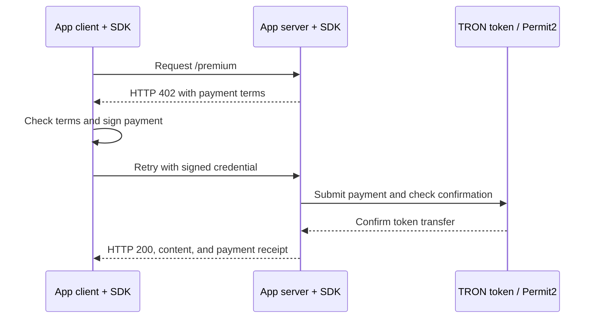
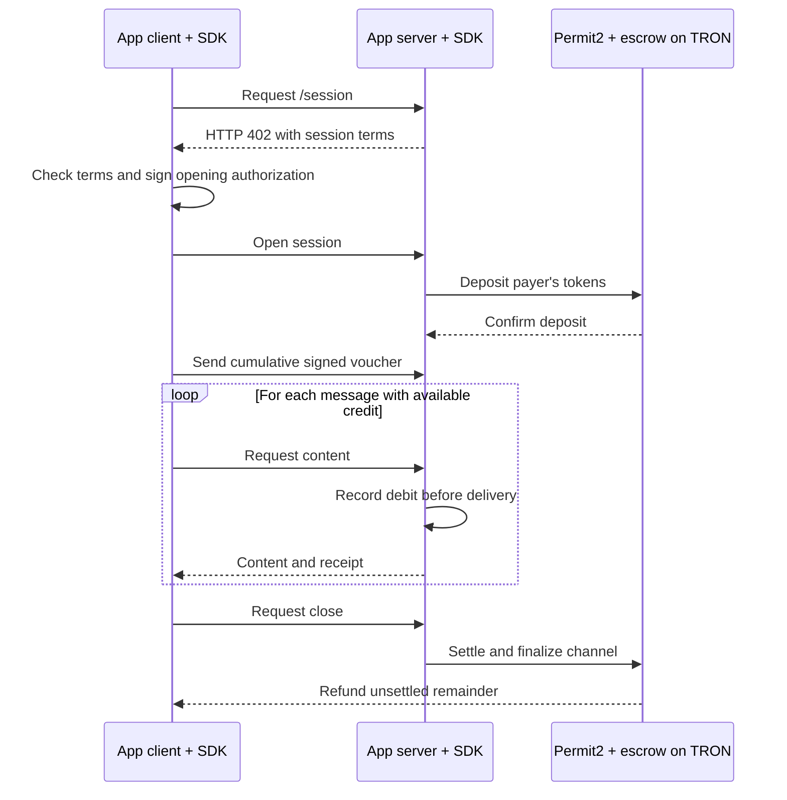

# TRON MPP SDK test app

This app lets you test the local `tron-mpp-sdk` with TRC-20 tokens on the TRON **Nile testnet**. It has two payment flows:

- **Charge:** pay once to get one response.
- **Session:** put tokens in an escrow, then pay for multiple messages using signed vouchers.

The default token is Nile USDT (`TXYZopYRdj2D9XRtbG411XZZ3kM5VkAeBf`). Payments use tokens, not native TRX. Wallets may still need Nile TRX or resources to send transactions.

## What happens where?

- **This app** provides the example client, HTTP server, commands, configuration, example content, and local storage. It chooses the price and checks that the payment terms match its settings. For sessions, the app decides when to debit each message.
- **The SDK** provides the TRON payment methods, challenge and credential handling, signature and payment verification, receipts, and session accounting and management. The app connects the SDK to TRON and provides storage for its records.
- **TRON contracts** hold or transfer the tokens. In a session, the separately deployed escrow holds the deposit until settlement or refund.

The app is a test harness. Its charge journal is in memory, and its session files are for a single local process. A production service needs suitable shared, persistent storage and recovery for its own content delivery.

## Setup for both flows

1. Use Node.js 22.22 or later. Make sure the SDK is available at `../tron-mpp-sdk`, then build it and install this app's dependencies:

   ```sh
   cd ../tron-mpp-sdk
   npm run build
   cd ../tron-mpp-sdk-app-test
   npm install
   ```

   Rebuild the SDK after changing it so this app uses its updated build.

2. If you do not already have a `.env` file, create one from the example:

   ```sh
   cp .env.example .env
   ```

   Do not overwrite an existing `.env`: it may contain your keys and settings.

3. Set `TRON_PAYER_PRIVATE_KEY` to a dedicated Nile test wallet's key and `TRON_RECIPIENT_ADDRESS` to the merchant's address. Generate a secret with `openssl rand -base64 32` and put the result in `MPP_SECRET_KEY`. Keep `.env` private and out of Git. Fund the payer with Nile USDT and enough TRX/resources for any payer transactions.

4. Check that `TRON_FULL_HOST` points to a Nile node. The SDK uses the configured chain ID; it does not automatically discover the node's network. Addresses can be Base58Check, `41`-prefixed hex, or 20-byte `0x` hex.

5. Run the local checks:

   ```sh
   npm run check
   npm test
   ```

   `check` checks TypeScript. `test` runs automated tests with test keys and simulated chain receipts; it does not load `.env`, contact Nile, or spend funds. A live test is still needed to check your deployed contracts and configuration.

Amounts in `.env` are whole **atomic units**, not decimal numbers. USDT has six decimals: `1000000` means 1 USDT, and `100000` means 0.1 USDT.

## Charge intent: pay once

The charge server protects `GET /premium` on port **3000**. It offers one configured credential type:

- `transaction` (default): the client signs a token transfer; the server submits it.
- `permit2`: the client signs a Permit2 authorization; the server's relayer submits it.

In either case the SDK checks the payment and confirms the token transfer before the app returns its example content. Charge does not use a session escrow.

### Charge sequence



### Test a transaction charge

1. In `.env`, set `CHARGE_CREDENTIAL_TYPE=transaction`. Set `PAYMENT_AMOUNT_ATOMIC` and `MAX_PAYMENT_AMOUNT_ATOMIC` to `1000000` for a 1 USDT test. The second value is the client's spending limit.
2. Start the server in one terminal:

   ```sh
   npm run charge:server
   ```

3. In a second terminal, inspect the payment request and then pay:

   ```sh
   npm run charge:challenge
   npm run charge:client
   ```

   The challenge command checks and prints the HTTP 402 terms without paying. The client command makes a **live Nile payment**. Expect HTTP 200, premium content, and a `Payment-Receipt` after confirmation.

### Test a Permit2 charge

1. In `.env`, set `CHARGE_CREDENTIAL_TYPE=permit2`, `TRON_PERMIT2_ADDRESS`, `TRON_RELAYER_PRIVATE_KEY`, and `TRON_PERMIT2_SPENDER_ADDRESS`. The spender must be the address belonging to the relayer key. The merchant recipient may be a different address. The example file contains the [Nile Permit2 address](https://docs.sun.io/protocols/sunswap-v4/reference/contract/). Fund the relayer with Nile TRX/resources.
2. Keep the token, payer, recipient, secret, and amount settings from setup. To show the relayer address without printing its private key, run:

   ```sh
   node --env-file=.env --input-type=module -e "import { TronWeb } from 'tronweb'; console.log(TronWeb.address.fromPrivateKey(process.env.TRON_RELAYER_PRIVATE_KEY.replace(/^0x/, '')))"
   ```

3. Run `npm run charge:inspect` to check the token, balances, Permit2 allowance and signing domain. It does not sign or pay. Check `domainMatchesSdk` and `balanceCoversClientCap` are true.
4. Run `npm run charge:approve` to give Permit2 an allowance equal to `MAX_PAYMENT_AMOUNT_ATOMIC`. This sends an on-chain transaction but does not transfer tokens. If a different nonzero allowance exists, run `npm run charge:revoke` first. Run `charge:inspect` again and check `allowanceCoversClientCap`.
5. Start `npm run charge:server` in one terminal. In another, run `npm run charge:challenge`, followed by `npm run charge:client`. The latter makes a **live Nile payment**. Expect HTTP 200, a receipt, and a confirmed transaction hash. Inspect the balances again or look up the hash on [Nile Tronscan](https://nile.tronscan.org/).

### Charge commands

Run each with `npm run`, for example `npm run charge:client`.

- `charge:server` — starts the charge server.
- `charge:challenge` — checks and prints the payment terms without paying.
- `charge:client` — makes one live payment and requests the content.
- `charge:inspect` — reads Permit2 and token details, balances, and allowance.
- `charge:approve` — sets the token allowance for Permit2; it sends a transaction.
- `charge:revoke` — clears the token allowance for Permit2; it sends a transaction.
- `charge:replay` — makes a **separate live payment**, then resends the same credential to test replay protection. Expect the first request to return 200 and the replay to return 402, without a second transfer. In Permit2 mode, ensure enough allowance remains first.

If a charge returns 503 or its result is uncertain, keep the server running and investigate the original transaction before starting another payment. `charge:client` creates a new credential every time. The SDK also exposes reconciliation for operator recovery.

## Session intent: pay for multiple messages

The session server uses `/session` on port **3001**. It uses Permit2 regardless of `CHARGE_CREDENTIAL_TYPE`. A **deposit** is tokens held in escrow; a **voucher** is the payer's signed authorization for a cumulative total the merchant may claim. Adding a deposit alone does not increase the voucher.

With the example settings, each message costs 0.1 USDT, the initial deposit is 1 USDT, and the deposit and voucher limits are each 2 USDT. Settlement can pay the highest accepted voucher; closing refunds the amount not settled.

### Session sequence



A stream can stop and request a higher voucher when its authorized credit runs out. The merchant can also settle an accepted voucher before closing; the payer can add funds with a top-up.

### Prepare a session

1. Deploy `TronPaymentChannel` separately from `../tron-mpp-sdk-contract`, using TRON-compiled bytecode, the configured Permit2 address, an allowlist containing the token, and a close grace period of at least 900 seconds. This app does not deploy it.
2. Set `TRON_SESSION_ESCROW_ADDRESS` to the deployed contract. Set `TRON_RELAYER_PRIVATE_KEY` and fund that relayer with Nile TRX/resources. Set `TRON_PAYEE_PRIVATE_KEY` to the key for `TRON_RECIPIENT_ADDRESS`, unless the relayer is already that merchant. The merchant signs settlement and close authorizations; the relayer submits them.
3. Check the `SESSION_*` settings in `.env.example`. `SESSION_MAX_DEPOSIT_ATOMIC` and `SESSION_MAX_CUMULATIVE_ATOMIC` are separate client limits. The payer needs enough tokens for the deposit and TRX/resources for approval or forced withdrawal.
4. For sessions, the escrow is the Permit2 spender; the payer still grants the token allowance to Permit2. `TRON_PERMIT2_SPENDER_ADDRESS` is only for charge. Both flows share the token's Permit2 allowance, so check that no charge is pending before changing it.

### Test a session

Start the server in one terminal:

```sh
npm run session:server
```

In a second terminal, run these one at a time and check each result:

```sh
npm run session:inspect
npm run session:challenge
npm run session:approve
npm run session:open
npm run session:voucher
npm run session:pay
npm run session:stream
npm run session:merge
npm run session:stream
npm run session:settle
npm run session:voucher -- 1200000
npm run session:pay
npm run session:close
npm run session:inspect
```

With the default six-decimal amounts, the first voucher authorizes 0.4 USDT. The single paid message uses 0.1; the first stream delivers three more messages, then asks for a higher voucher and reports 0.4 spent. Merge adds 1 USDT to the deposit and raises the voucher to 0.8 USDT. The next stream can deliver four more messages. Settlement pays the highest accepted voucher; the later voucher and payment demonstrate continued use before closing. Closing settles at least the delivered and already settled amounts and refunds the remainder.

### Session commands

Run each with `npm run`, for example `npm run session:open`.

- `session:server` — starts the session server and checks the escrow configuration.
- `session:inspect` — reads deployment checks, balance, allowance, channel, receipt, and pending operation.
- `session:challenge` — checks the HTTP 402 terms without signing or paying.
- `session:approve` — grants Permit2 the configured maximum deposit allowance; sends a transaction but transfers no tokens. If a different nonzero allowance exists, revoke it first.
- `session:revoke` — clears the remaining Permit2 allowance; sends a transaction.
- `session:open` — signs the opening request and funds escrow; it does not buy service credit.
- `session:voucher` — raises the cumulative amount the merchant may claim. By default it adds four message units; `session:voucher -- 600000` sets the total to 0.6 USDT.
- `session:pay` — receives one JSON message and records one unit of spending.
- `session:stream` — receives up to `SESSION_STREAM_UNITS` messages, charging before each one, and returns a final receipt.
- `session:topup` — adds the configured amount to escrow without increasing the voucher. For example, `session:topup -- 500000` adds 0.5 USDT.
- `session:merge` — adds the configured top-up and raises the voucher in one request. `session:merge -- 1200000` sets the voucher total to 1.2 USDT.
- `session:settle` — operator action that settles the highest accepted voucher on-chain.
- `session:close` — finalizes the channel, settles at least what was delivered or already settled, and refunds the remainder.
- `session:replay` — resends the last successful credential to test replay handling; it does not create a new permit. A paid request or open is rejected, while a repeated voucher update can be accepted without billing again.
- `session:retry` — retries a saved pending request or checks a saved payer transaction hash, without creating a second deposit.
- `session:reconcile` — operator action that checks the state of an uncertain operation; inspect the returned state to see whether it is resolved.
- `session:request-close` — starts the payer's forced-close grace period.
- `session:withdraw` — after the grace period, lets the payer withdraw the unsettled remainder.

### Session recovery

The client saves pending credentials before submitting them, and the server saves its accounting in `SESSION_STATE_DIR` (default `.data/session`). Use a separate directory when changing wallets, token, escrow, or server port.

After a network failure or HTTP 503, run `session:inspect`, then `session:retry`. If a paid request has expired, retry stops because the content may already have been delivered; inspect and reconcile it before making another paid request. A transaction with no known hash also needs investigation. Do not delete the journals to force another payment.

For forced close, run `session:request-close`, wait for the escrow's reported grace period, and then run `session:withdraw`. The built-in adapter cannot automatically confirm an external forced withdrawal in server accounting. See [Session testing](docs/SESSION_TESTING.md) for recovery details, limitations, and the full forced-close procedure.
